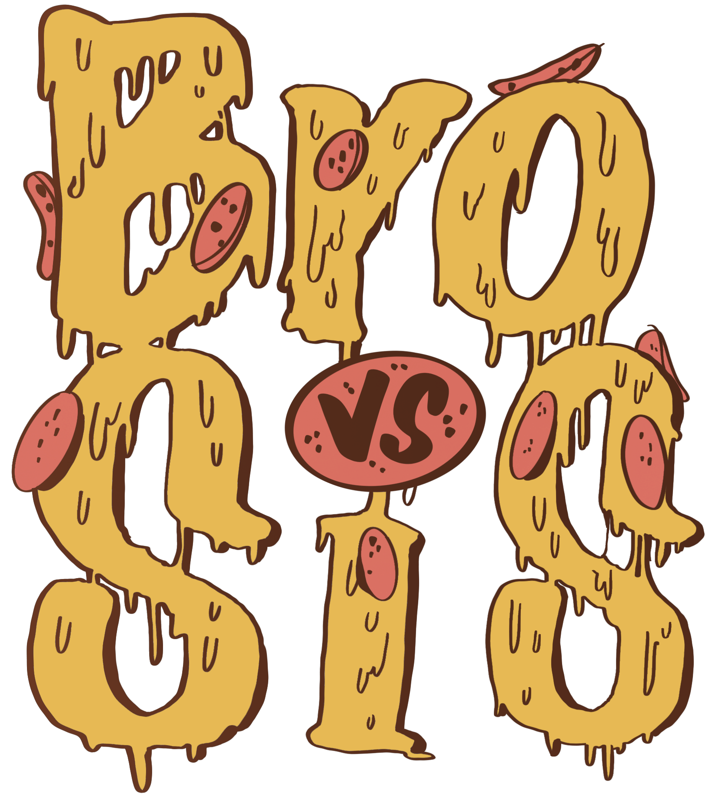

# BroVSis (BVS)

<div align="center">
  
</div>

A **2D fighting game** built in **Godot 4** designed specifically for **Reinforcement Learning** training and experimentation. Train your own AI fighters and test them against each other in fights!


## 🌟 Features

### 🎮 Game Features
- **2D Fighting Mechanics**: Classic fighting game with movement, jumping, and combat
- **Multiple Characters**: Rafael and Matilde with unique sprites and animations (everyone is free to add Its own)
- **Dynamic Character System**: Modular character loading with animation frames
- **Real-time Combat**: Physics-based fighting with collision detection

### 🤖 AI & Machine Learning
- **Reinforcement Learning Ready**: Built with Godot RL Agents integration
- **Multi-Control Modes**: Human, Training, ONNX Inference, and Demo Recording
- **Rich Observation Space**: Position, velocity, ground detection, opponent tracking
- **Reward System**: Built-in reward mechanisms for AI training
- **HuggingFace Integration**: Direct model loading from HuggingFace Hub

### 🌐 HuggingFace Space Integration
- **Live Model Testing**: Upload and test your trained models in real-time
- **Community Models**: Browse and try models from other users (searching BVS1.0 in HuggingFace)
- **One-Click Download**: Seamless model deployment from HuggingFace Hub
- **ONNX Support**: Universal model format for cross-platform compatibility

## 🚀 Quick Start

### Prerequisites
- **Godot 4.4+**: Download from [Godot homepage](https://godotengine.org/) or, if you can't find it, [Godot archiv](https://godotengine.org/download/archive/)
- **Python 3.8+**: For training (optional)
- **Godot RL Agents**: Pre-installed in the project

### 🎯 Running the Game

1. **Clone the repository**:
   ```bash
   git clone https://github.com/RafaelJaime/Bro-VS-SiS-game.git
   cd Bro-VS-SiS-game
   ```

2. **Open in Godot**:
   - Launch Godot Engine
   - Click "Import" and select the project folder
   - Open `project.godot`

3. **Play the game**:
   - Press `F5` or click the play button
   - Use arrow keys + space for Player 1 controls
   - Train AI opponents or play against friends!

### 🌐 Play Online (GitHub Pages)

The game is automatically deployed to GitHub Pages on every push to the `main` branch:

1. **Access the live game**: Visit the GitHub Pages URL for this repository
2. **No installation needed**: Play directly in your browser
3. **Automatic updates**: New features are deployed automatically via GitHub Actions

The deployment workflow:
- Exports the game to HTML5/Web format using Godot 4.4
- Deploys to GitHub Pages automatically
- Can be manually triggered from the Actions tab

## 🧠 AI Training

### Control Modes

The game supports multiple AI control modes:

- **🎮 HUMAN**: Manual player control
- **🏋️ TRAINING**: Connect to Python training server
- **🤖 ONNX_INFERENCE**: Use pre-trained ONNX models
- **📹 RECORD_EXPERT_DEMOS**: Record human gameplay for imitation learning

### Observation Space

The AI observes a comprehensive state vector including:

```gdscript
- Player position (x, y) normalized
- Player velocity (x, y) normalized  
- Ground contact detection
- Opponent position (x, y) normalized
- Opponent velocity (x, y) normalized
- Relative position to opponent
- Distance to opponent
- Opponent ground contact
```

### Action Space

AI agents can perform these actions:
- **Move Left/Right**: Continuous values [-1, 1]
- **Jump**: Binary action [0, 1]
- **Attack**: Binary action [0, 1] 
- **Shoot Projectile**: Binary action [0, 1]

### Training Setup

1. **Install Godot RL Agents**:
   ```bash
   pip install godot-rl
   ```

2. **Start training server**:
   ```bash
   gdrl --env=bvs --experiment=ppo_fight
   ```

3. **Run the game** with training mode enabled

## 🤗 HuggingFace Integration

### Model Manager

The game includes a sophisticated model management system:

```gdscript
# Load models from HuggingFace Hub
ModelManager.fetch_user_models("username", player_id)
ModelManager.download_model("username/model_name", player_id)
```

### Supported Model Format

- **ONNX Models**: Universal format for cross-platform deployment
- **HuggingFace Hub**: Direct integration with model repository
- **Auto-download**: Seamless model fetching and caching

### Creating Your Own Models

1. **Train using Godot RL Agents**
2. **Export to ONNX format**
3. **Upload to HuggingFace Hub** with tag `BVS`
4. **Test in the game** or HuggingFace Space

## 🏗️ Project Structure

```
bvs/
├── 🎮 game/                    # Core game logic
│   ├── player/                 # Fighter characters and AI
│   ├── projectile/             # Combat projectiles
│   └── ui/                     # Game UI elements
├── 🧠 autoload/                # Autoloads and scene manager
│   ├── model_manager.gd        # HuggingFace integration
│   └── scene_manager.gd        # Scene transitions
├── 🎨 assets/                  # Game assets
│   ├── images/characters/      # Character sprites
│   └── backgrounds/            # Environment art
├── 🔌 addons/                  # Godot plugins
│   └── godot_rl_agents/        # RL integration
└── 🖥️ ui/                      # Interface components
```

## 🎨 Character System

### Adding New Characters

1. **Create character folder**: `assets/images/game/characters/new_character/`
2. **Add animation folders**: `idle/`, `walk/`, `jump/`, `attack/`, etc.
3. **Place sprite frames**: Sequential PNG files (1.png, 2.png, ...)
4. **Create a `.tres` file**:
   - Open Godot and create a new `Character` resource.
   - Configure the character's properties (e.g., name, animations, stats).
   - Save the `.tres` file in the character's folder.

5. **Add the character to the selection list**:
   - Open the `character_select` scene.
   - Add the new `.tres` file to the `characters` array in the script or inspector.

## 📚 Learning Resources

### Reinforcement Learning
- [Godot RL Agents Documentation](https://github.com/edbeeching/godot_rl_agents)
- [Stable Baselines3](https://stable-baselines3.readthedocs.io/)
- [OpenAI Gym](https://gym.openai.com/)

### Godot Development
- [Godot Documentation](https://docs.godotengine.org/)
- [GDScript Reference](https://docs.godotengine.org/en/stable/tutorials/scripting/gdscript/)
- [2D Game Development Guide](https://docs.godotengine.org/en/stable/tutorials/2d/)

## 🏆 Achievements & Metrics

Track your AI training progress:
- **Win Rate**: Against different opponents
- **Training Episodes**: Total learning iterations  
- **Reward Curves**: Performance over time
- **Battle Statistics**: Detailed combat analytics

## 📄 License

This project is licensed under the MIT License - see the [LICENSE](LICENSE) file for details.

## 🙏 Acknowledgments

- **Godot Engine**: Amazing open-source game engine
- **Godot RL Agents**: Edward Beeching's fantastic RL integration
- **HuggingFace**: Platform for model sharing and deployment
- **Community**: All contributors and AI researchers

## 📞 Support & Community

- **GitHub Issues**: Bug reports and feature requests
- **Discussions**: Share your trained models and results
- **HuggingFace Space**: Try the live demo
- **Discord**: Join our AI gaming community

---

**Ready to train the ultimate AI fighter?** 🥊 Start your journey in BVS today!

[](https://huggingface.co/spaces/RafaelJaime/BroVSister)
[](#ai-training)
